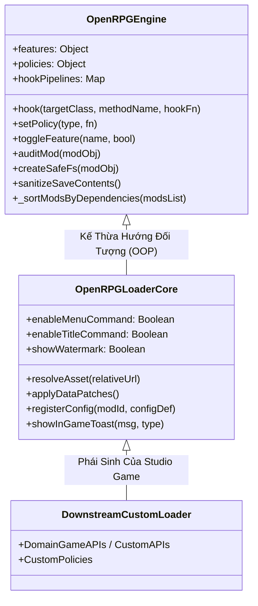

# Kiến Trúc Hai Tầng Phong Cách Chromium (Two-Tier Architecture)

> **Mục tiêu**: Phân tích sâu nguyên lý tách tầng giữa phần Lõi Vô Hình (`OpenRPGEngine`) và Vỏ Ứng Dụng (`OpenRPGLoaderCore`), giải thích tại sao 9/10 bản tái bản chỉ cần viết ~30 dòng code trong khi 1/10 có thể override sạch sẽ từng phương thức.

---

## 1. Vấn Đề Của Kiến Trúc Mod Loader Kiểu Cũ

Trong các dự án modding truyền thống, mã nguồn bộ nạp thường bị viết theo dạng **nguyên khối (monolithic spaghetti)**:
* Logic kiểm toán bảo mật, thuật toán sắp xếp đồ thị, giải quyết tài nguyên lại nằm xen kẽ với mã tạo cửa sổ RPG Maker MZ (`Window_Base`, `Scene_Menu`).
* Khi một studio game muốn tạo bản loader riêng hoặc thay đổi cơ chế menu, họ buộc phải **fork (sao chép toàn bộ hàng ngàn dòng code)**.
* **Hậu quả**: Khi lõi upstream sửa lỗi bảo mật hoặc vá lỗ hổng rò rỉ bộ nhớ, các bản fork phái sinh gần như không thể cập nhật được vì xung đột mã nguồn.

---

## 2. Giải Pháp: Mô Hình Hai Tầng Kế Thừa (Chromium Paradigm)

Tương tự cách **The Chromium Project** phân tách giữa `Chromium Content API` (lõi hiển thị và JavaScript) và các trình duyệt thành phẩm (Chrome, Edge, Brave), OpenRPG phân chia rạch ròi thành 2 tầng kỹ thuật:



---

## 3. Chi Tiết Từng Tầng Kỹ Thuật

### Tầng 1: OpenRPGEngine (Lõi Vô Hình - Headless Core)
* **Vị trí**: `src/OpenRPGEngine.js`
* **Đặc tính**: Hoàn toàn **Headless**, trung lập, không phụ thuộc vào bất kỳ biến toàn cục nào của RPG Maker MZ (`DataManager`, `SceneManager`, `Graphics`).
* **Trách nhiệm đảm nhiệm**:
  1. **Khám phá & Kê khai**: Quét thư mục mod, phân tích cú pháp `mod.json`, bóc tách header plugin dạng cũ.
  2. **Giải quyết đồ thị phụ thuộc (Dependency Resolution)**: Thuật toán Topo Sort (DFS) sắp xếp thứ tự nạp mod theo chuẩn SemVer 2.0.0, tự động ngắt và đánh dấu lỗi chu trình lặp (Cycle Detection).
  3. **Hộp cát thực thi 2 pha (Two-Phase Sandbox)**: Staged execution -> Commit/Rollback khi có lỗi.
  4. **Kiểm soát bảo mật động**: `createSafeFs`, Safe Process mock, Granular Permissions (`network:outbound`, `child_process:exec`...).
  5. **Cầu dao tự ngắt lỗi (Circuit Breaker)**: Theo dõi tần suất exception của từng hook, ngắt kết nối an toàn khi vượt ngưỡng.
  6. **Bảo vệ dữ liệu lưu (Save Shield)**: Cách ly và khử trùng ID vật phẩm, trang bị, nhân vật mồ côi.

### Tầng 2: OpenRPGLoaderCore (Vỏ Tương Thích RPG Maker MZ)
* **Vị trí**: `src/OpenRPGLoader.js`
* **Đặc tính**: Là lớp con (`class OpenRPGLoaderCore extends OpenRPGEngine`), đóng gói toàn bộ logic đồ họa và tương thích với RPG Maker MZ.
* **Trách nhiệm đảm nhiệm**:
  1. **Tích hợp giao diện MZ**: Tự động chèn lệnh "Bản Mod (Mods)" vào `Window_TitleCommand` và `Window_MenuCommand`.
  2. **Giao diện đáp ứng (Responsive UI)**: Các lớp `Scene_Mods`, `Scene_ModConfig`, `Window_OpenRpgModList` co giãn linh hoạt theo `Graphics.boxWidth` và `Graphics.boxHeight`.
  3. **Hệ thống Toast thông báo**: Lớp thông báo nổi mượt mà không làm dừng mạch chơi game.
  4. **Định tuyến tài nguyên ảo (Virtual Asset Resolver)**: Hook vào `ImageManager` và `AudioManager` để trỏ đường dẫn ảnh/nhạc sang thư mục của mod mà không sửa file gốc.
  5. **Vá dữ liệu 14 bảng MZ**: Tự động quét thư mục `data/*.patch.json` của từng mod và thực thi RFC 6902 JSON-Patch vào `$dataItems`, `$dataSkills`, `$dataEnemies`...

---

## 4. Tỉ Lệ 9/10 vs 1/10 Trong Thực Tế

### 9/10 Trường Hợp: Kế Thừa Thuần Túy (~30 Dòng Mã)
Hầu hết các nhà phát triển game (ví dụ nhóm làm game Fantasy RPG, Cyberpunk RPG...) **chỉ cần kế thừa** `OpenRPGLoaderCore`, tinh chỉnh các cờ tính năng và nhúng API riêng của game vào:

```javascript
class FantasyCombatLoader extends OpenRPGLoaderCore {
    constructor() {
        super({ features: { strictQuarantine: false, saveShield: true } });
        this.ArtifactSystem = { /* domain APIs */ };
    }
}
```

### 1/10 Trường Hợp: Can Thiệp Chuyên Sâu (Method Overriding)
Các dự án đặc biệt cần thay đổi toàn bộ UI (ví dụ chuyển sang theme Cyberpunk bằng HTML5 Overlay, hoặc lưu file save lên Cloud MongoDB) có thể **override sạch sẽ từng hàm** mà không phải sửa một dòng nào của lớp cha:

```javascript
class CloudCyberpunkLoader extends OpenRPGLoaderCore {
    // Ghi đè giao diện UI chuẩn bằng HTML5 Canvas UI riêng
    setupInGameUI() {
        MyCustomHtmlOverlay.mount();
    }

    // Ghi đè cơ chế lưu cấu hình mod lên Cloud API
    saveModConfigValues(modId, values) {
        CloudApi.syncConfig(modId, values);
    }
}
```

---

👉 Bước tiếp theo:  
[**02. Vòng Đời Thực Thi 7 Giai Đoạn & Đồ Thị Topo Sort**](02_Lifecycle_and_Execution_Pipeline.md)
