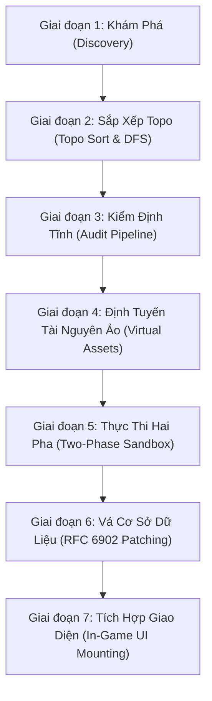

# Vòng Đời Thực Thi 7 Giai Đoạn & Đồ Thị Topo Sort (Lifecycle Pipeline)

> **Mục tiêu**: Làm rõ quy trình 7 giai đoạn khởi động của OpenRPGLoader, thuật toán sắp xếp đồ thị phụ thuộc Topo Sort bằng DFS, cơ chế phát hiện chu trình lặp (Cycle Detection) và nguyên lý Two-Phase Sandbox.

---

## 1. Sơ Đồ Toàn Cảnh Vòng Đời Khởi Động

Khi trò chơi RPG Maker MZ bắt đầu chạy, OpenRPGLoader can thiệp vào chu trình khởi động thông qua một pipeline gồm **7 giai đoạn tuần tự**:



---

## 2. Chi Tiết Từng Giai Đoạn

### Giai Đoạn 1: Khám Phá & Đọc Siêu Dữ Liệu (Discovery)
* Hệ thống quét thư mục `mods/`.
* Tự động nhận diện hai loại mod:
  1. **Folder Mod**: Thư mục chứa `mod.json` hoặc `index.js`.
  2. **Single-File Plugin Mod**: Tệp `.js` đứng một mình (tự động bóc tách comment header `@id`, `@version`, `@deps`).
* Gán trạng thái ban đầu: `discovered` (nếu kích hoạt) hoặc `disabled` (nếu nằm trong danh sách tắt của người chơi).

### Giai Đoạn 2: Giải Quyết Đồ Thị Phụ Thuộc Bằng Topo Sort (DFS)
* Nếu Mod A phụ thuộc Mod B, và Mod B phụ thuộc Mod C, thứ tự nạp bắt buộc phải là: **Mod C -> Mod B -> Mod A**.
* **Thuật toán DFS & Phát hiện chu trình lặp (Cycle Detection)**:
  * Hệ thống sử dụng 2 tập hợp: `visiting` (đang duyệt nhánh) và `visited` (đã duyệt xong).
  * Nếu một mod con quay ngược lại gọi một mod tổ tiên đang nằm trong tập `visiting`, thuật toán sẽ **phát hiện chu trình lặp (Circular Dependency)**:
    ```text
    Mod X -> phụ thuộc Mod Y -> phụ thuộc Mod X
    ```
  * **Xử lý sự cố**: Mod bị lặp chu trình sẽ được đánh dấu trạng thái `error` với thông báo lỗi chi tiết, không làm treo đơ hay đệ quy vô tận.

### Giai Đoạn 3: Kiểm Định Tĩnh Không Cực Đoan (Audit Pipeline)
* Phân tích tĩnh mã nguồn qua 9 lớp tiêu chuẩn:
  * Lớp 1: Manifest siêu dữ liệu hợp lệ.
  * Lớp 2: Kiểm tra phiên bản phụ thuộc (SemVer).
  * Lớp 3: Cú pháp mã và quét chuỗi rủi ro (`while(true){}`).
  * Lớp 4: Quyền hệ điều hành (`child_process`, `fs.unlink`, `process.exit`).
  * Lớp 5: Mô phỏng chạy thử (Dry-Run).
  * Lớp 6–9: Kiểm tra hợp đồng Hook, Assets, Save và Fuzzing.
* **Bộ nhớ đệm SHA-256 (Audit Cache)**: Kết quả kiểm tra được lưu kèm hash tệp. Lần mở game thứ hai chỉ mất **< 1ms** để xác nhận kiểm định.
* **Cơ chế Soft Advisory (`strictQuarantine: false`)**: Mod có điểm thấp chỉ bị cảnh báo huy hiệu vàng/đỏ chứ không bị cấm nạp cưỡng chế, chuyển trọng tâm an toàn sang cơ chế Circuit Breaker tại runtime.

### Giai Đoạn 4: Định Tuyến Tài Nguyên Ảo (Virtual Asset Redirection)
* Hook vào `ImageManager.loadBitmap` và `AudioManager.playBgm`.
* Khi game yêu cầu tải `img/characters/Hero.png`, hệ thống tự động kiểm tra xem các mod đang active có chứa tệp này trong `mods/<mod_id>/img/characters/Hero.png` không. Nếu có, game sẽ tải tệp của mod thay thế mà **không ghi đè file gốc trên đĩa**.
* **Quy ước giải quyết xung đột (Last-Loaded Wins)**: Nếu cả Mod A và Mod B cùng thay thế chung một tệp tài nguyên, hệ thống áp dụng nguyên tắc **Nạp sau thắng (Last-Loaded Wins)** dựa trên thứ tự đồ thị Topo Sort. Mod nào nạp sau sẽ có quyền ưu tiên hiển thị.

### Giai Đoạn 5: Thực Thi Hai Pha (Two-Phase Sandbox Execution)
Khi nạp mã JavaScript của từng mod:
* **Pha 1 (Staging)**: Mod được cung cấp một môi trường Sandbox cô lập (chứa `sFs` từ Safe-FS, `sProc` ngăn chặn `process.exit`, hàm `require` cục bộ đã được đánh chặn, đối tượng `Forge` riêng). Mọi hook mod đăng ký được đưa vào hàng đợi tạm (`staged.hooks`).
* **Pha 2 (Commit / Rollback)**:
  * Nếu mod chạy hết tệp mà không ném lỗi: Hệ thống commit toàn bộ hook vào vòng lặp game chính, chuyển trạng thái sang `active`.
  * Nếu mod ném lỗi ngoại lệ: Hệ thống hủy bỏ toàn bộ hook đã đăng ký dở dang (Rollback), gán trạng thái `error` và cách ly hoàn toàn mod, bảo vệ game không bị sập.

> [!WARNING]
> #### ⚠️ CẢNH BÁO QUAN TRỌNG VỀ THỨ TỰ TẢI CƠ SỞ DỮ LIỆU:
> Tại thời điểm mã JavaScript của Mod thực thi (**Giai đoạn 5**), cơ sở dữ liệu của game (`$dataItems`, `$dataSkills`, `$dataWeapons`...) **CHƯA ĐƯỢC TẢI VÀO BỘ NHỚ** (vì RPG Maker MZ tải dữ liệu bất đồng bộ qua `DataManager`).  
> * **TUYỆT ĐỐI KHÔNG** truy cập trực tiếp `$dataItems[...]` ở cấp ngoài cùng (top-level) của `index.js`, vì biến này lúc đó là `null` hoặc `undefined`!
> * **Cách làm chuẩn**: Nếu bạn muốn đọc hoặc xử lý dữ liệu game sau khi đã được vá hoàn chỉnh bởi các tệp `.patch.json` (**Giai đoạn 6**), hãy đăng ký qua hàm callback:
>   ```javascript
>   Forge.onDatabaseLoaded(() => {
>       console.log("Dữ liệu sau khi vá hoàn tất:", $dataItems[1].price);
>   });
>   ```

### Giai Đoạn 6: Vá Cơ Sở Dữ Liệu MZ (RFC 6902 Patch Application)
* Lắng nghe sự kiện `DataManager.isDatabaseLoaded()`.
* Tự động quét các tệp `.patch.json` trong thư mục `data/` của từng mod đang active.
* Áp dụng tuần tự các phép biến đổi RFC 6902 (`add`, `replace`, `remove`, `move`, `copy`, `test`) trực tiếp vào 14 bảng dữ liệu toàn cục (`$dataItems`, `$dataSkills`, `$dataWeapons`...).
* Tự động điền phần tử `null` vào các khoảng trống nếu mod chèn ID vượt quá độ dài mảng hiện tại.

### Giai Đoạn 7: Tích Hợp Giao Diện Game (In-Game UI Mounting)
* Tự động chèn lệnh "Bản Mod (Mods)" vào màn hình Title và Pause Menu.
* Đăng ký phím nóng `F8` để mở nhanh `Scene_Mods`.
* Vẽ watermark số lượng mod đã nạp ở góc dưới màn hình Title Screen.

---

## 3. Bảng Tóm Tắt Trạng Thái Vòng Đời Của Mod

| Trạng thái | Ý nghĩa | Hành vi của hệ thống |
| :--- | :--- | :--- |
| `discovered` | Mới phát hiện trong thư mục | Đưa vào hàng đợi chuẩn bị sắp xếp đồ thị |
| `active` | Nạp thành công và đang chạy | Hook và tài nguyên ảo được áp dụng đầy đủ |
| `disabled` | Người chơi tạm tắt trong Menu | Không nạp mã, bỏ qua tài nguyên ảo |
| `conflict` | Xung đột với mod khác trong danh sách | Tạm ngưng kích hoạt để tránh xung đột |
| `error` | Bị lỗi cú pháp, chu trình lặp hoặc crash | Cách ly an toàn, hiển thị chi tiết stack trace trong menu F8 |
| `quarantined` | Bị kiểm định tĩnh cách ly cưỡng chế | Chỉ xuất hiện khi bật cờ `strictQuarantine: true` |

---

👉 Bước tiếp theo:  
[**03. Bộ Ba Cơ Chế Phòng Vệ Chủ Động (Defensive Systems)**](03_Defensive_Mechanisms.md)
