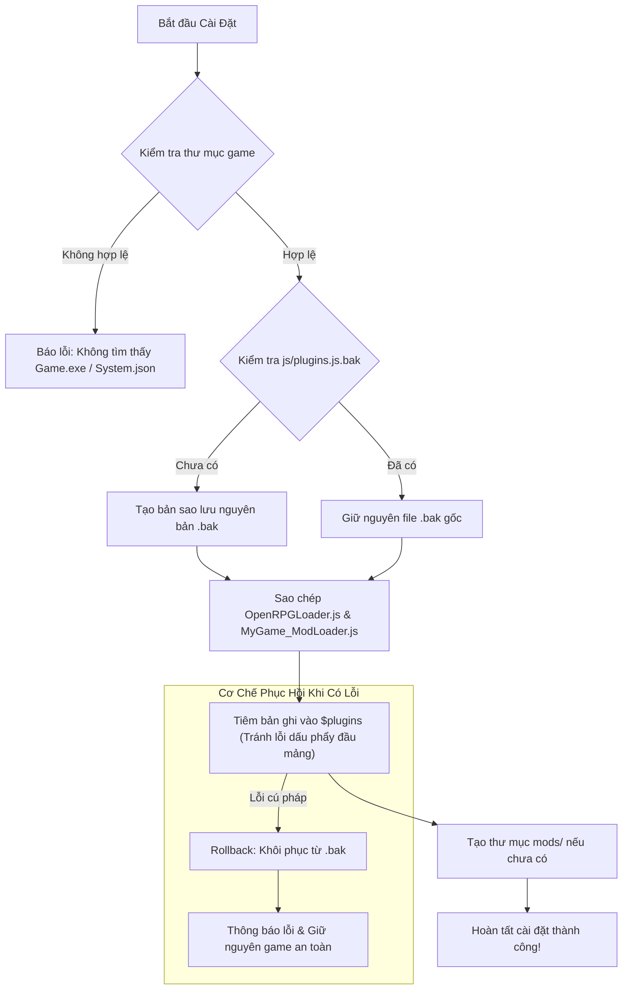

# Hướng Dẫn B5: Xây Dựng Trình Cài Đặt Bộ Nạp Tự Động (Installer / Setup Wizard)

> **Dành cho**: Studio game hoặc nhà phát triển bộ nạp phái sinh (Derivative Loader) muốn đóng gói bộ nạp thành một tệp cài đặt (Setup/Installer) hoàn chỉnh, giúp người chơi chỉ cần nhấn một nút là tích hợp thành công vào game mà không phải mở mã nguồn sửa thủ công `js/plugins.js`.

---

## 1. Tại Sao Cần Trình Cài Đặt Tự Động?

Người chơi thông thường (End-Users) thường không có kỹ năng lập trình hoặc ngần ngại việc phải mở các tệp cấu hình như `js/plugins.js` để chỉnh sửa bằng tay. Một sơ suất nhỏ như thiếu dấu phẩy `,` hoặc nhầm ngoặc vuông `]` có thể khiến trò chơi không thể khởi động.

Một trình cài đặt (Installer) chuẩn mực sẽ thực hiện toàn bộ quy trình này trong vài giây:
1. **Tự động nhận diện thư mục game** (Dò tìm `Game.exe`, `package.json`, `data/System.json`).
2. **Sao lưu an toàn (Atomic Backup)**: Tạo tệp `js/plugins.js.bak` nếu chưa có (tuyệt đối không đè mất bản gốc nếu cài lại lần 2).
3. **Sao chép đầy đủ cả tầng Lõi (`OpenRPGLoader.js`) và tầng Phái sinh (`MyGame_ModLoader.js`)** vào `js/plugins/`.
4. **Tiêm an toàn vào `js/plugins.js`**: Đăng ký cả hai plugin theo đúng thứ tự (Lõi trước, Phái sinh sau) mà không làm ảnh hưởng đến các plugin RPG Maker MZ khác.
5. **Khởi tạo thư mục `mods/`** và chép các tệp tài nguyên ban đầu.
6. **Cung cấp cơ chế hoàn tác (Rollback / Uninstaller)** gỡ bỏ sạch sẽ khi người chơi yêu cầu.

---

## 2. Kiến Trúc An Toàn Của Một Bộ Cài Đặt RPG Maker MZ



---

## 3. Cách 1: Xây Dựng Bộ Cài Đặt Bằng Node.js Script

Kịch bản này tự động xử lý cả hai plugin, kiểm tra backup và tiêm cú pháp JavaScript hợp lệ 100%.

### Mã Nguồn Hoàn Chỉnh: `installer_engine.js`

```javascript
/**
 * installer_engine.js - Trình cài đặt tự động cho Derivative Mod Loader
 * Đảm bảo cài đặt cả Lõi gốc OpenRPGLoader.js và Bộ nạp phái sinh MyGame_ModLoader.js
 */
const fs = require("fs");
const path = require("path");

class ModLoaderInstaller {
    constructor(gameDir, customLoaderName = "MyGame_ModLoader") {
        this.gameDir = path.resolve(gameDir);
        this.coreLoaderName = "OpenRPGLoader";
        this.customLoaderName = customLoaderName;
    }

    // 1. Thẩm định tính hợp lệ của thư mục trò chơi
    validateGameDir() {
        const exePath = path.join(this.gameDir, "Game.exe");
        const pluginsJsPath = path.join(this.gameDir, "js", "plugins.js");
        const systemJsonPath = path.join(this.gameDir, "data", "System.json");

        if (!fs.existsSync(this.gameDir)) {
            throw new Error(`Thư mục không tồn tại: ${this.gameDir}`);
        }
        if (!fs.existsSync(pluginsJsPath)) {
            throw new Error("Không tìm thấy tệp 'js/plugins.js'! Vui lòng chọn đúng thư mục gốc của game RPG Maker MZ.");
        }

        let gameTitle = "RPG Maker MZ Game";
        if (fs.existsSync(systemJsonPath)) {
            try {
                const sysData = JSON.parse(fs.readFileSync(systemJsonPath, "utf8"));
                if (sysData.gameTitle) gameTitle = sysData.gameTitle;
            } catch (e) {}
        }

        console.log(`✔ Xác thực thành công tựa game: [${gameTitle}]`);
        return true;
    }

    // 2. Cài đặt Loader vào game
    install(sourceCorePath, sourceCustomPath) {
        this.validateGameDir();

        const jsPluginsDir = path.join(this.gameDir, "js", "plugins");
        const pluginsJsPath = path.join(this.gameDir, "js", "plugins.js");
        const backupPluginsJs = path.join(this.gameDir, "js", "plugins.js.bak");
        const targetCorePath = path.join(jsPluginsDir, `${this.coreLoaderName}.js`);
        const targetCustomPath = path.join(jsPluginsDir, `${this.customLoaderName}.js`);
        const modsDir = path.join(this.gameDir, "mods");

        // Bước 1: Sao chép tệp Lõi và tệp Phái sinh vào js/plugins/
        console.log("[1/4] Sao chép tệp mã nguồn vào thư mục js/plugins/...");
        if (!fs.existsSync(jsPluginsDir)) {
            fs.mkdirSync(jsPluginsDir, { recursive: true });
        }
        fs.copyFileSync(sourceCorePath, targetCorePath);
        fs.copyFileSync(sourceCustomPath, targetCustomPath);

        // Bước 2: Tạo bản sao lưu an toàn (chỉ tạo nếu chưa tồn tại để không ghi đè mất bản gốc)
        if (!fs.existsSync(backupPluginsJs)) {
            console.log("[2/4] Tạo bản sao lưu nguyên bản: js/plugins.js.bak");
            fs.copyFileSync(pluginsJsPath, backupPluginsJs);
        } else {
            console.log("[2/4] Đã tìm thấy tệp backup gốc js/plugins.js.bak, giữ nguyên.");
        }

        // Bước 3: Đọc và tiêm an toàn vào mảng $plugins
        console.log("[3/4] Cập nhật danh sách plugin trong js/plugins.js");
        try {
            const rawContent = fs.readFileSync(pluginsJsPath, "utf8");
            const match = rawContent.match(/var\s+\$plugins\s*=\s*(\[[\s\S]*?\]);?/);
            if (!match) {
                throw new Error("Định dạng tệp js/plugins.js không chuẩn (không tìm thấy biến var $plugins)!");
            }

            const pluginsArray = JSON.parse(match[1]);

            // Hàm phụ trợ: Thêm hoặc kích hoạt plugin
            const registerPlugin = (name, description) => {
                const existing = pluginsArray.find(p => p.name === name);
                if (existing) {
                    existing.status = true;
                } else {
                    pluginsArray.push({
                        name: name,
                        status: true,
                        description: description,
                        parameters: {}
                    });
                }
            };

            // Đăng ký LÕI TRƯỚC, PHÁI SINH SAU
            registerPlugin(this.coreLoaderName, "OpenRPGLoader Core Framework");
            registerPlugin(this.customLoaderName, "Custom Game Mod Loader Extension");

            // Ghi lại tệp plugins.js với định dạng chuẩn
            const newContent = `// Generated by ModLoader Setup\nvar $plugins =\n${JSON.stringify(pluginsArray, null, 4)};\n`;
            fs.writeFileSync(pluginsJsPath, newContent, "utf8");
        } catch (err) {
            console.error("❌ Xảy ra lỗi khi tiêm plugin! Đang hoàn tác lại từ bản sao lưu...");
            if (fs.existsSync(backupPluginsJs)) {
                fs.copyFileSync(backupPluginsJs, pluginsJsPath);
            }
            throw err;
        }

        // Bước 4: Khởi tạo thư mục mods/ cho người chơi
        console.log("[4/4] Khởi tạo thư mục chứa mod: mods/");
        if (!fs.existsSync(modsDir)) {
            fs.mkdirSync(modsDir, { recursive: true });
            fs.writeFileSync(
                path.join(modsDir, "README.txt"),
                "Chép các thư mục bản mod của bạn vào đây.\nMỗi bản mod phải chứa tệp kê khai 'mod.json'.",
                "utf8"
            );
        }

        console.log("\n🎉 CHÚC MỪNG: Bộ Nạp Mod Đã Được Cài Đặt Thành Công Vào Trò Chơi!");
    }
}

// Chạy trực tiếp qua dòng lệnh CLI
if (require.main === module) {
    const targetFolder = process.argv[2] || process.cwd();
    const sourceCore = path.join(__dirname, "OpenRPGLoader.js");
    const sourceCustom = path.join(__dirname, "MyGame_ModLoader.js");

    console.log("==================================================");
    console.log("       TRÌNH CÀI ĐẶT BỘ NẠP MOD TỰ ĐỘNG           ");
    console.log("==================================================");

    try {
        const installer = new ModLoaderInstaller(targetFolder, "MyGame_ModLoader");
        installer.install(sourceCore, sourceCustom);
    } catch (e) {
        console.error("\n❌ CÀI ĐẶT THẤT BẠI:", e.message);
        process.exit(1);
    }
}

module.exports = ModLoaderInstaller;
```

---

## 4. Cách 2: Kịch Bản Cài Đặt 1-Click Bằng PowerShell (Không Cần Cài Node.js)

Để người chơi không cần cài thêm Node.js, bạn có thể sử dụng PowerShell — công cụ có sẵn 100% trên mọi máy tính Windows 10 và 11.

### Tệp Chạy: `Install_ModLoader.bat`

```bat
@echo off
title Cai Dat Mod Loader
cd /d "%~dp0"

echo Dang khoi chay trinh cai dat...
powershell -ExecutionPolicy Bypass -File "installer.ps1"
pause
```

### Tệp Logic: `installer.ps1`

```powershell
$ErrorActionPreference = "Stop"
Write-Host "=======================================================" -ForegroundColor Cyan
Write-Host "         TRINH CAI DAT BO NAP MOD TU DONG              " -ForegroundColor Cyan
Write-Host "=======================================================" -ForegroundColor Cyan
Write-Host ""

$gameDir = Get-Location
$pluginsJs = Join-Path $gameDir "js\plugins.js"
$pluginsDir = Join-Path $gameDir "js\plugins"
$backupFile = Join-Path $gameDir "js\plugins.js.bak"

if (!(Test-Path $pluginsJs)) {
    Write-Host "[LOI] Khong tim thay 'js\plugins.js'! Hay dat bo cai vao thu muc game." -ForegroundColor Red
    exit 1
}

# 1. Sao luu plugins.js (chi sao luu neu chua co file .bak)
if (!(Test-Path $backupFile)) {
    Write-Host "[1/3] Sao luu ban goc thanh js\plugins.js.bak..." -ForegroundColor Yellow
    Copy-Item $pluginsJs $backupFile
}

# 2. Chep cac file Loader
Write-Host "[2/3] Chep file bo nap vao js\plugins\..." -ForegroundColor Yellow
if (!(Test-Path $pluginsDir)) { New-Item -ItemType Directory -Path $pluginsDir | Out-Null }
Copy-Item "OpenRPGLoader.js" (Join-Path $pluginsDir "OpenRPGLoader.js") -Force
Copy-Item "MyGame_ModLoader.js" (Join-Path $pluginsDir "MyGame_ModLoader.js") -Force

# 3. Cap nhat plugins.js an toan
Write-Host "[3/3] Dang ky bo nap vao js\plugins.js..." -ForegroundColor Yellow
$content = Get-Content $pluginsJs -Raw

# Tranh trung lap
if ($content -notmatch "MyGame_ModLoader") {
    $hasPlugins = $content -match "\{"
    $comma = if ($hasPlugins) { "," } else { "" }
    
    $records = "$comma`r`n    {""name"":""OpenRPGLoader"",""status"":true,""description"":""Core"",""parameters"":{}},`r`n    {""name"":""MyGame_ModLoader"",""status"":true,""description"":""Loader"",""parameters"":{}}`r`n];"
    $content = $content -replace "\]\s*;\s*$", $records
    Set-Content -Path $pluginsJs -Value $content -Encoding UTF8
}

$modsDir = Join-Path $gameDir "mods"
if (!(Test-Path $modsDir)) { New-Item -ItemType Directory -Path $modsDir | Out-Null }

Write-Host ""
Write-Host "[THANH CONG] Bo nap da duoc cai dat thanh cong!" -ForegroundColor Green
```

---

## 5. Cách 3: Đóng Gói Thành File Cài Đặt Đồ Họa Bằng Inno Setup (`.exe`)

**Inno Setup** cung cấp giao diện Wizard chuẩn mực cho Windows. Dưới đây là kịch bản đã được khắc phục hoàn toàn lỗi dấu phẩy đầu mảng và cơ chế chống đè file `.bak`:

### Kịch Bản Mẫu: `ModLoader_Setup.iss`

```iss
[Setup]
AppName=My Game Custom Mod Loader
AppVersion=1.0.0
DefaultDirName={autopf}\MyRPGGame
DefaultGroupName=My Game Mod Loader
OutputDir=Output
OutputBaseFilename=MyGame_ModLoader_Setup
Compression=lzma2/ultra64
SolidCompression=yes
WizardStyle=modern

[Files]
; BẮT BUỘC sao chép CẢ HAI tệp Lõi và Phái sinh
Source: "src\OpenRPGLoader.js"; DestDir: "{app}\js\plugins"; Flags: ignoreversion
Source: "src\MyGame_ModLoader.js"; DestDir: "{app}\js\plugins"; Flags: ignoreversion

; Sao chép tệp hướng dẫn vào thư mục mods
Source: "resources\README.txt"; DestDir: "{app}\mods"; Flags: ignoreversion

[Code]
// Kiểm tra thư mục game hợp lệ
function NextButtonClick(CurPageID: Integer): Boolean;
var
  PluginsFile: String;
begin
  Result := True;
  
  if CurPageID = wpSelectDir then
  begin
    PluginsFile := ExpandConstant('{app}\js\plugins.js');
    if not FileExists(PluginsFile) then
    begin
      MsgBox('Thư mục được chọn không phải là trò chơi RPG Maker MZ hợp lệ!' + #13#10 + 
             'Không tìm thấy tệp "js\plugins.js". Vui lòng chọn lại đúng thư mục cài game.', mbError, MB_OK);
      Result := False;
    end;
  end;
end;

// Cập nhật js/plugins.js sau khi copy file
procedure CurStepChanged(CurStep: TSetupStep);
var
  PluginsFile, BakFile, Content: AnsiString;
  Injection: AnsiString;
begin
  if CurStep = ssPostInstall then
  begin
    PluginsFile := ExpandConstant('{app}\js\plugins.js');
    BakFile := ExpandConstant('{app}\js\plugins.js.bak');
    
    // 1. Chỉ sao lưu nếu chưa có file .bak (FailIfExists = True) để không ghi đè mất bản gốc
    if not FileExists(BakFile) then
    begin
      FileCopy(PluginsFile, BakFile, True);
    end;
    
    // 2. Đọc nội dung và tiêm plugin
    if LoadStringFromFile(PluginsFile, Content) then
    begin
      // Kiểm tra xem đã cài chưa để tránh trùng lặp
      if Pos('MyGame_ModLoader', Content) = 0 then
      begin
        // Xử lý thông minh: Nếu mảng rỗng (không có '{'), không thêm dấu phẩy đứng đầu
        if Pos('{', Content) > 0 then
          Injection := '  ,{"name":"OpenRPGLoader","status":true,"description":"Core Engine","parameters":{}}' + #13#10 +
                       '  ,{"name":"MyGame_ModLoader","status":true,"description":"Custom Loader","parameters":{}}' + #13#10 + '];'
        else
          Injection := '  {"name":"OpenRPGLoader","status":true,"description":"Core Engine","parameters":{}}' + #13#10 +
                       '  ,{"name":"MyGame_ModLoader","status":true,"description":"Custom Loader","parameters":{}}' + #13#10 + '];';
        
        StringChange(Content, '];', Injection);
        SaveStringToFile(PluginsFile, Content, False);
      end;
    end;
  end;
end;
```

---

## 6. Danh Mục Kiểm Tra An Toàn Trước Khi Phát Hành Bộ Cài Đặt

Trước khi đưa tệp Setup ra cộng đồng, hãy kiểm tra danh sách sau:
- [ ] Tệp Setup có sao chép và đăng ký **cả hai tệp** `OpenRPGLoader.js` (Lõi) và `MyGame_ModLoader.js` (Phái sinh) theo đúng thứ tự không?
- [ ] Tệp Setup có tạo bản sao lưu `.bak` và **không ghi đè** khi người dùng chạy lại lần 2 không?
- [ ] Đã thử nghiệm trên tệp `js/plugins.js` rỗng (`var $plugins = [];`) để đảm bảo không bị lỗi cú pháp dấu phẩy đứng đầu mảng chưa?
- [ ] Thư mục `mods/` có được tạo tự động nếu người dùng mới cài lần đầu không?
- [ ] Đã kiểm tra trường hợp đường dẫn game có khoảng trắng (`C:\Program Files (x86)\...`) chưa?

---

👉 Chuyển sang phần tra cứu kỹ thuật chi tiết:  
[**01. Đặc Tả Tệp Kê Khai `mod.json`**](../../04_API_Reference/01_Manifest_mod_json_Spec.md)
